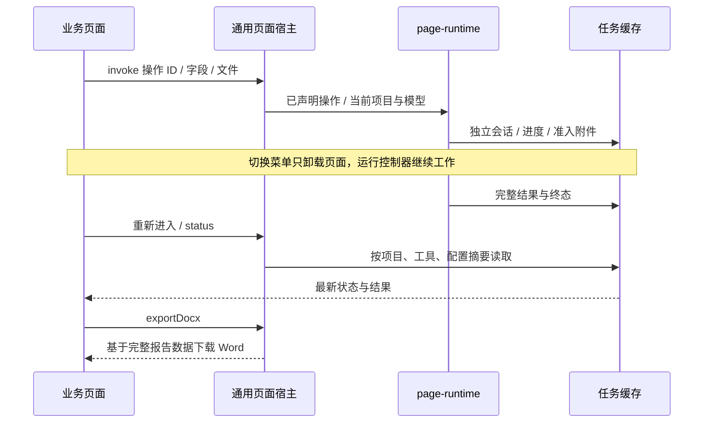

# 自定义页面与执行配置

新建业务页面默认生成 HTML。页面只调用声明的操作 ID；模型提示、技能选择和结果契约保存在独立执行配置中。通用能力由宿主实现，标书栏目等业务约束留在工具目录及项目技能内。

```mermaid
flowchart LR
  Request[页面需求] --> Generate[页面生成 / 可选创建技能]
  Generate --> Split[Main splitToolPage / 配置校验]
  Split --> Page[index.html / 展示与输入]
  Split --> Actions[actions.json / 指令与结果约束]
  Split --> Manifest[momo-tool.json / 权威提交记录]
  Page --> Frame[沙箱 iframe / window.momo]
  Frame -->|操作 ID / 字段 / File| Bridge[来源窗口与 token 校验]
  Actions --> Bridge
  Bridge --> Runtime[内置 model.generate / page-runtime]
  Runtime --> Upload[上传 / SourceRef]
  Runtime --> Harness[共享 Harness / ToolBroker]
  Upload --> Harness
  Harness --> Artifact[完整 JSON 产物 / artifact_create]
  Artifact -->|准入 SourceRef| Validate[读取与结果契约校验]
  Validate --> Store[按项目与工具配置隔离的任务缓存]
  Store --> Data[通用报告 / 或页面业务数据]
  Data --> Export[完整数据转 Word / 全章节全行]
```

宿主只内置模型调用、附件传递、后台状态、停止、结构化报告展示与 Word 导出。`model.generate` 复用已有 `harnessPort`，不新增模型凭证通道或私有执行 IPC。页面自身不注册 Agent 全局工具；显式创建的“AI 工具”仍使用已有插件校验和注册流程。

工具目录为 `<应用根>/temp/custom-tools/<目录>/<工具>/`，包含 `index.html`、`actions.json` 和 `momo-tool.json`。生成输出中的 `momo-actions` JSON script 仅作为生成封装，Main 在保存前校验并剥离；权威清单保留同一配置，actions.json 是可查看的独立副本。画布修改保留原配置，编辑器“执行设置”单独编辑业务指令。旧 `default/plugins/user` 与用户数据目录按来源标记只复制一次，原件保留；不会将项目页面动作打进系统插件镜像。此 temp 子目录是工具持久工作区，不由会话清理器删除。

报告契约不固定业务栏目：`sections` 为一级导航，`groups` 为二级导航，`blocks` 支持文本、动态表格及真实文件引用。工具可声明 `requiredSections`，校验器要求名称和顺序完全匹配；出处为独立字段，导出不读取当前可见 DOM。大报告可通过 `resultSourceId` 返回已登记 JSON，宿主只读取本次任务准入附件或产物，限制 8 MB，并核验引用文件确实存在。普通 JSON 结果返回页面自行展示。

页面桥接只接受当前 iframe、会话 token 和声明的操作；不暴露 Electron、模型配置或任意路径读取。结果文本保持字面值，文件预览沿用 SourceRef 与 momo-file-editor。报错使用业务提示，用户流程不展示底层页面语法或组件调试信息。

页面通过受控高度消息自适应 iframe，宿主统一滚动。任务在当前应用内存中持续更新，并尝试缓存显示数据；浏览器配额不足时清除旧缓存，保留当前内存结果，切换菜单不受影响。此情况下重启后需要重新运行，原文件与已登记产物仍由 Harness 保存。

原有 OpenUI 工具和聊天界面继续使用兼容链路，见 [通用交互工具任务](./interactive-tool-tasks.md)。标书业务配置见 [标书解析技能](./tender-document-parser-skill.md)。
