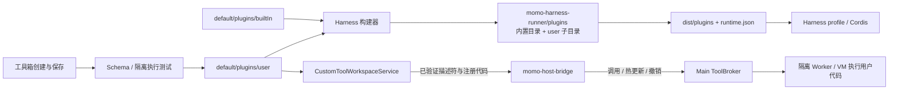

# Harness 插件目录与加载

`apps/skill-platform/default/plugins` 是插件的统一来源。`builtIn` 保存系统桥接与凭证插件；`user` 保存工具箱创建的自定义工具、插件定义及经过验证的执行代码。首次访问时将旧 `data/tools` 复制到 `user`，同名目录另存为“旧版”副本，保留原文件。

构建递归包含两类目录的全部文件，保持内置插件的稳定运行路径；额外内置 `index.mjs` 入口进入 profile。`--ensure` 同时检查新增、修改和删除。用户插件通过现有宿主校验及热注册进入会话，磁盘上的未验证脚本不会直接作为系统插件执行。构建镜像不能作为第二份可编辑源码。
