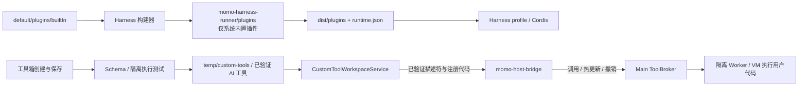

# Harness 插件目录与加载

`apps/skill-platform/default/plugins/builtIn` 保存系统桥接与凭证插件，是运行镜像的唯一插件来源。业务页面、动作配置与自定义 AI 工具保存到 `temp/custom-tools`；首次访问按来源标记复制旧 `default/plugins/user` 与 `data/tools`，保留原件。页面动作仅对当前页面开放，不注册全局 Agent 能力。

构建只递归包含 builtIn，保持内置插件的稳定运行路径；额外内置 `index.mjs` 入口进入 profile。`--ensure` 同时检查新增、修改和删除。用户插件通过现有宿主校验及热注册进入会话，磁盘上的未验证脚本不会直接作为系统插件执行。构建镜像不能作为第二份可编辑源码。页面与独立执行配置见 [自定义页面](./custom-tool-pages.md)。
