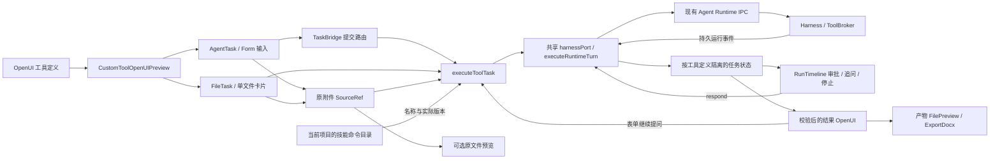
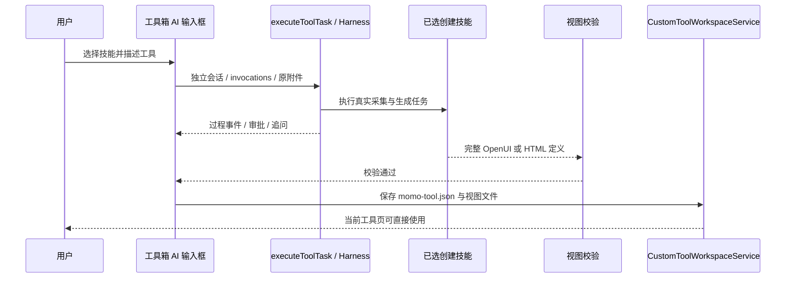

# 通用交互工具任务

工具定义、业务技能和执行宿主分离。`AgentTask` 接受任意 Form 字段和可选附件，`FileTask` 提供单文件卡片；任务指令、技能名、阶段标签与结果结构均来自 OpenUI 定义。标书解析仅是绑定业务技能的一个配置，宿主不按业务名称分支。

任务独立于主聊天，首次执行绑定项目供重试和后续提问使用，复用当前模型、项目资源、上传存储、运行时协议与审批机制，没有新增私有执行 IPC。`executeToolTask` 的结果阶段拒绝再次返回输入任务组件；工具定义阶段允许这些组件。原文件和产物仅通过准入 SourceRef 访问，缓存不保存文件字节。

`tool-task` Store 以工具或聊天消息标识、定义内容摘要及 statementId 隔离状态，持久化至 `custom-tool-tasks`。切换菜单重挂载时恢复附件、过程和结果，仍在当前 Renderer 运行的控制器继续推送事件；应用重启后未结束的显示快照标记为已停止，可重试。定义变更启用新键，防止显示旧指令的结果。运行事件的权威记录仍在现有 Agent SQLite 运行记录中。

## 技能创建工具

`interactive-tool-builder` 面向通用表单与内容生成任务；`rea-page-rebuild` 先采集网站证据再生成定义。创建视图的显式技能在工具页执行并保存，默认 OpenUI，明确 HTML 或科技设计技能保留 HTML 沙箱入口；AI 插件编辑器的既有技能聊天入口保持原有行为。普通视图描述继续走文本生成与修复链路。聊天中的工具界面属于该轮快照，不自动创建工具箱文件。

新增业务通常只需工具定义和可选业务技能，业务模块不进入宿主代码。
