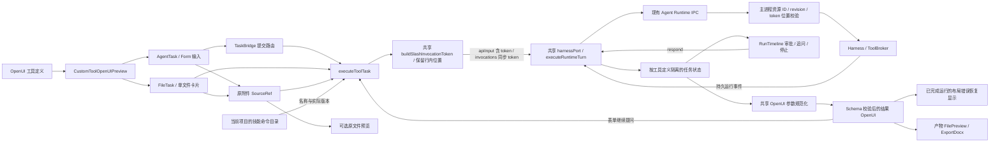
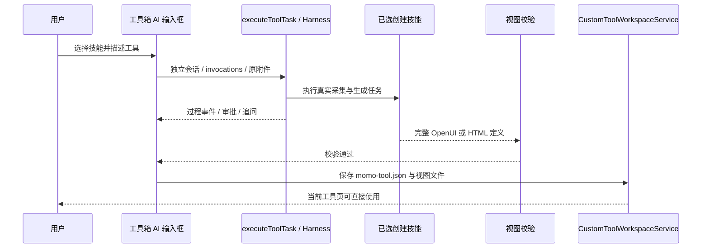

# 通用交互工具任务

新建工具页面使用独立 HTML 与执行配置，结果为结构化数据；系统通用能力和存储边界见 [自定义页面与执行配置](./custom-tool-pages.md)。以下 AgentTask / FileTask 链路继续支持已有工具与聊天界面。

工具定义、业务技能和执行宿主分离。`AgentTask` 接受任意 Form 字段和可选附件，`FileTask` 提供单文件卡片；任务指令、技能名、阶段标签与结果结构均来自 OpenUI 定义。标书解析仅是绑定业务技能的一个配置，宿主不按业务名称分支。

任务独立于主聊天，首次执行绑定项目供重试和后续提问使用，复用当前模型、项目资源、上传存储、运行时协议与审批机制，没有新增私有执行 IPC。`executeToolTask` 的结果阶段拒绝再次返回输入任务组件；工具定义阶段允许这些组件。原文件和产物仅通过准入 SourceRef 访问，缓存不保存文件字节。

工具定义中的技能名先从当前项目目录解析出资源 ID 和 revision，再通过 `@momo/aichat` 的共用序列化函数生成行内 token；程序化调用补到输入开头，编辑器已选 token 保留原位置。`apiInput` 与 `invocations[].token` 一致，`displayInput` 转为可读命令名，资源只在 Main 展开。工具创建输入框不再提前把 token 转成纯文本；主进程仍拒绝资源变更、失效引用和缺少位置的请求。

`FileTask` 未产生结果前的运行阶段只显示处理卡片、原文件名、进度和停止入口，隐藏上传区；有可渲染结果后切换到结果区。失败时保留原文件并恢复重试入口，错误展示去掉 Electron IPC 包装。切换菜单后同一个任务键继续接收进度，返回时恢复当前阶段。

生成、预览、结果校验和 DOCX 导出共用 OpenUI 参数规范化：仅将 Stack 缩短位置参数末尾的布尔值移至第六个 wrap 参数，并用 null 补齐 align/justify；显式命名错误、歧义参数与业务文本保留原样交由 Schema 校验。历史任务若最后的运行终态为 run.completed、旧错误仅为该布尔值布局错误且当前完整源码校验通过，可直接恢复结果显示，无需重新分析或改写运行事件。

`tool-task` Store 以工具或聊天消息标识、定义内容摘要及 statementId 隔离状态，持久化至 `custom-tool-tasks`。切换菜单重挂载时恢复附件、过程和结果，仍在当前 Renderer 运行的控制器继续推送事件；应用重启后未结束的显示快照标记为已停止，可重试。定义变更启用新键，防止显示旧指令的结果。运行事件的权威记录仍在现有 Agent SQLite 运行记录中。

## 技能创建工具

`interactive-tool-builder` 面向通用表单与内容生成任务；`rea-page-rebuild` 先采集网站证据再生成定义。创建视图的显式技能在工具页执行并保存，默认 OpenUI，明确 HTML 或科技设计技能保留 HTML 沙箱入口；AI 插件编辑器的既有技能聊天入口保持原有行为。普通视图描述继续走文本生成与修复链路。聊天中的工具界面属于该轮快照，不自动创建工具箱文件。

新增业务通常只需工具定义和可选业务技能，业务模块不进入宿主代码。
