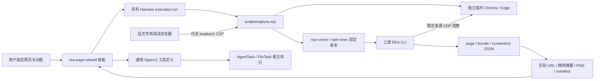

# REA 网页证据与工具生成

`rea-page-rebuild` 是可导入的普通技能，调用上游 `rea-agents@6.8.0`。脚本通过 npm exec 缓存固定版本 REA 和 Node 24.22.1，不运行 setup、不改全局 Agent 配置或应用 Node。需系统 npm、Chrome/Edge 及首次下载网络连接。

默认启动独立无头浏览器和临时 profile，退出只清理此次创建的 profile。`--cdp` 仅接受带端口的本机 loopback 端点，只选择指定来源页面；可用于用户已在专用浏览器登录的页面。取消和超时终止此次 CLI 进程树，不读取日常浏览器配置或凭证。

manifest 分别记录各采集操作的成功/失败及完整性，实际落地 URL 来自 REA evidence；页面跳转单独提示。`captured` 表示获得证据文件，不能推断登录后功能已恢复。截图解码并校验 SHA-256 后保存 PNG；page-summary 只保留限定数量的可访问性文本和脚本 URL，大脚本按需定向读取。静态脚本候选、已观察行为与未知接口必须区分。

工具箱中的显式技能调用走[通用工具创建链路](./interactive-tool-tasks.md)，经真实 Harness 工具调用采集后校验保存。外观依据可见页面或用户截图校准；业务处理依赖现有技能、已验证 AI 插件或 API/MCP 能力。
