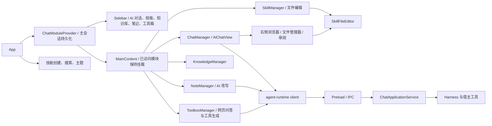

# Renderer 功能入口

提示词和工作流的导航、编辑器、资源树、状态、业务服务、导入导出、IPC 与独立工作流包均已删除。笔记文件树继续使用 `useTreeRootCreate`；顶栏保留技能创建、搜索和主题切换。默认打开 AI 对话。

主 ChatProvider 位于菜单内容之外。MainContent 按首次访问加载模块，再以隐藏容器保留其 React 状态、问答和输入；切换菜单或设置不卸载这些模块。ChatManager 的右侧 Portal 保持实例，随可见状态隐藏并设为 inert，避免覆盖其他菜单或设置。
