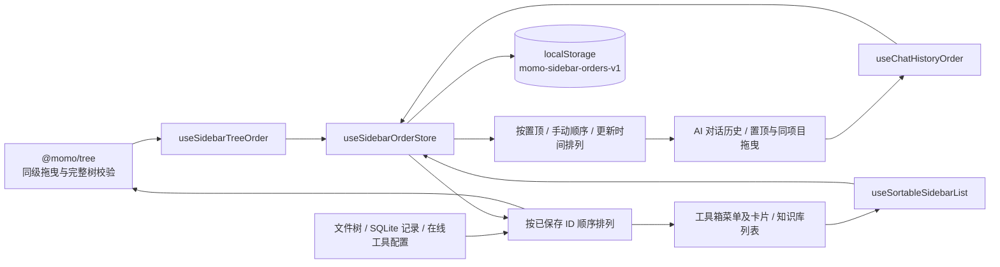

# 侧栏拖曳排序

排序以模块和父节点为键，分别覆盖 `toolbox`、`custom-tools`、`notes` 和 `knowledge`。完整树参与插入位置计算，搜索隐藏条目仍保留；新增条目接在已排序条目后。拖曳仅调整同级顺序，目录移动继续走原有业务接口。

排序是本机界面偏好，不改写工具在线配置、文件内容或业务数据库。先成功写入 localStorage，再更新界面；重载恢复顺序。笔记和自定义工具按路径标识，重命名或移动后映射节点及后代路径。

对话历史复用同一偏好存储：`chat-sessions` 按项目 ID 保存完整会话顺序，`chat-pinned-sessions` 的根节点保存置顶会话 ID。置顶记录始终排在所在项目顶部；置顶组、普通组各自支持拖曳，不跨项目或跨置顶状态移动。搜索仅过滤显示，拖曳以完整项目会话计算顺序；未手动排列的记录按更新时间排序。偏好不修改聊天内容、项目归属或云端会话契约。
