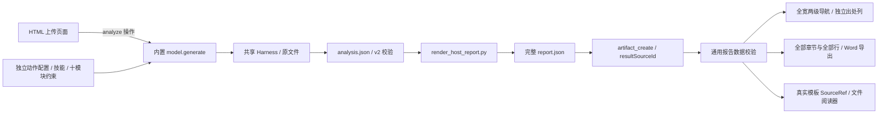

# 标书解析技能架构

`.cursor/skills/tender-document-parser` 把 PDF/DOCX 分析为带原文证据的动态数据；十个一级 Tab 固定，二级 Tab、表头和内容随文档生成。投标模板从原件截取为 Word；技能结果本身不重复原件栏，工具模式可由通用宿主按参数组合原件预览。

## 分离页面的工具模式

当前标书工具使用 `assets/tool-page.html` 和 `assets/tool-actions.json` 作为业务源，部署到 `temp/custom-tools/test/标书解析`。宿主不按技能名分支；十个模块与分析规则仅在业务配置及技能中维护。

任务只返回业务数据，不在分析完成后重新生成页面。长报告通过登记的 JSON 产物传递；宿主验证全部模块与真实模板引用，页面外层提供完整报告导出。历史 v1 文本模板不会被自动宣称为已抽取 Word；旧分析记录保留。通用能力、后台恢复和页面消息边界见 [自定义页面与执行配置](./custom-tool-pages.md)。

## 兼容聊天界面模式

以下图保留原有 OpenUI 聊天与旧 FileTask 工具的数据流。

```mermaid
flowchart LR
  Upload[上传原文件] --> Sources[Agent Source Store]
  Task[工具定义 FileTask] -->|上传 / 解析 / 结果| HostTask[通用任务执行宿主]
  HostTask --> Binding[目录解析技能 ID 与版本 / 构建行内 token]
  Binding -->|apiInput 与 invocations 位置一致| Harness
  HostTask --> Original[可选右侧原文件阅读器]
  Sources --> Original
  Chat[显式技能 / 界面模式] --> Harness[ChatRuntimePort / Harness]
  Sources --> Harness
  Resource[技能正文 / 真实资源目录] --> Harness
  Harness --> Text[scripts/extract_document.py / 全文分析]
  Text --> Data[analysis.json / schema_version 2]
  Harness --> Extract[scripts/extract_template.py]
  Extract -->|DOCX 原始 XML 与依赖部件| Word[截取 Word 模板]
  Extract -->|PDF 原页像素与页面尺寸| Word
  Word --> Temp[应用 temp / sessionId]
  Data --> Temp
  Temp -->|artifact_create path / 范围与大小校验| Artifact[产物快照 / sourceRef]
  Artifact -->|真实 source_id| Data
  Data --> Validate[render_report.py 数据校验]
  Validate --> Project[render_openui.py]
  Project --> OpenUI[唯一 OpenUI 围栏 / 全宽分析 Tabs / 独立出处列]
  OpenUI --> Host[ChatGeneratedView / 通用组件]
  OpenUI -->|ExportDocx 声明 / Portal| Toolbar[内容框外共用工具栏 / 左侧导出 / 右侧全屏]
  OpenUI --> Graph[通用 OpenUI 完整组件图]
  Toolbar --> Export[createOpenuiExportSurface]
  Graph -->|全部页签与表格所有行| Export
  Export -->|语义章节 / 固定列宽 / 重复表头| Download[完整分析 DOCX / Blob 下载]
  Artifact -->|artifact.created / 准入 sourceRefs| Host
  Host --> Preview[模板 Tab 内 FilePreview]
  Sources -->|按产物引用加载 Word 字节| Preview
  Preview --> Editor[momo-file-editor BinaryFilePreview]
  Validate -->|显式 HTML 请求| HTML[离线分析页 / 同目录 Word 链接]
```

业务布局与显隐由技能维护，宿主不按技能名分支。`template-extraction.md` 定义截取、视觉核验与产物注册步骤；`data-contract.md` 的模板块使用 `document.name/source_id/extraction`，不再用纯文本重建模板，也不再要求原件 sources.json 映射。

工具入口通过通用任务宿主补齐技能的行内 token，再交给 Main 校验版本和位置、展开技能，不能直接把无位置的目录项作为 invocation 发送。解析阶段隐藏上传卡片，完成后展示技能结果；调用失败保留原文件供重试。宿主状态与执行契约见 [通用交互工具任务](./interactive-tool-tasks.md)。

分析页根 Stack 声明一次 `ExportDocx`，宿主通过 Portal 把按钮放到白色内容框外的工具栏。导出解析完整 OpenUI 组件图，不遍历当前页面 DOM，因此包含十个一级 Tab、所有二级 Tab、空状态与表格分页后的全部行。通用导出器保留章节层级、换行、中文字体、A4 页边距、固定列宽及跨页重复表头；不会切换当前选中项或额外挂载文件阅读器。报告保留模板文件名、出处和单独下载说明，原版式模板仍由 `FilePreview` 下载。

`render_openui.py` 将分析表格的 `evidence/basis/note` 投影为独立“出处”列，不拼入建议或要求列；正文块使用“内容 / 出处”，模板预览后使用“模板文件 / 出处”。离线 HTML 采用相同的列分隔规则，业务列仍按文件动态生成。更新技能后运行 `pnpm --filter AIM run build:default-skills --skill tender-document-parser` 只重建此默认包。

聊天界面的导出和全屏由宿主放在同一行，技能不添加第二行操作或空白占位。浅色正文、表头及出处颜色由实例隔离的 OpenUI 主题提供；与深色工具箱同时挂载也不会共享颜色变量。

DOCX 路径仅裁剪正文 XML，保留原包内样式、编号、关系、图片和有效节属性。PDF 路径以 PyMuPDF 渲染选定物理页，按原尺寸嵌入 Word，明确标注图像内容不可逐字编辑。截取脚本测试校验原件不变、依赖部件字节、节属性、原页像素和尺寸；字体与分页的最终一致性仍需针对实际文件在 momo-file-editor 中视觉核验，未核验时不得宣称完全一致。

所有过程文件和交付文件保存到现有 `temp/<sessionId>`。宿主通过 artifact_create 读取该目录内的真实文件，生成持久化快照和预览引用；OpenUI 只持有引用，不嵌入原文件或 Word 字节。离线 HTML 不模拟宿主阅读器。

旧版 FileTask 仍按原参数运行；新工具使用上面的独立 HTML 页面和报告数据契约。旧版调用、重试和缓存见 [通用交互工具任务](./interactive-tool-tasks.md)。
